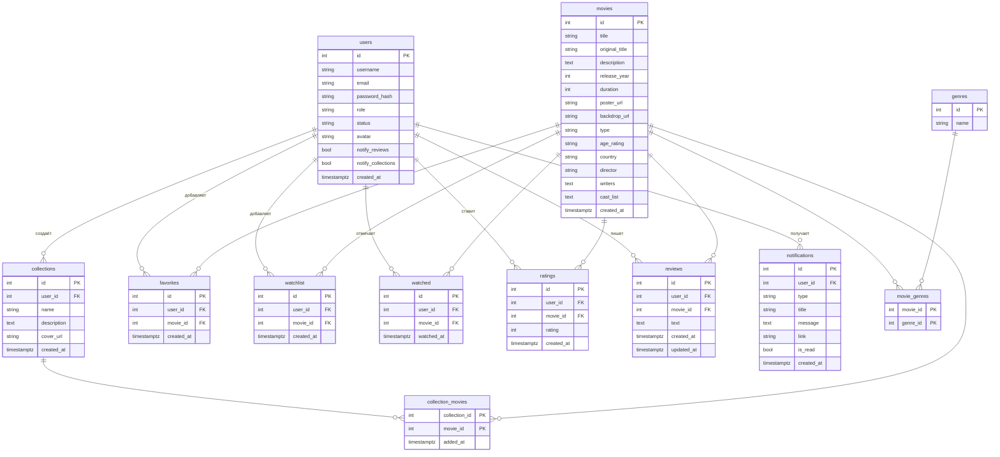

# База данных

PostgreSQL 16. Схема создаётся миграцией `server/src/database/migrations/001_create_tables.sql`,
демо-данные — `server/src/database/seeds/`. Нормализация: каждая сущность в своей таблице, связи через внешние ключи,
«многие-ко-многим» через связующие таблицы.

## ER-диаграмма

## Связи

- **Один ко многим:** пользователь → подборки, избранное, список просмотра, просмотренное, оценки, отзывы, уведомления.
- **Многие ко многим:** фильмы ↔ жанры (`movie_genres`), подборки ↔ фильмы (`collection_movies`).
- Таблицы `favorites`, `watchlist`, `watched`, `ratings`, `reviews` связывают пользователя и фильм.

## Ограничения и индексы

- Первичные ключи во всех таблицах; во внешних ключах `ON DELETE CASCADE` (удаление пользователя или фильма убирает связанные записи).
- `UNIQUE (user_id, movie_id)` в favorites, watchlist, watched, ratings, reviews: дубликаты невозможны на уровне БД.
- Уникальный индекс `LOWER(email)`: email уникален без учёта регистра. `UNIQUE (title, release_year)` у фильмов, `UNIQUE(name)` у жанров.
- `CHECK`: оценка 1–10, роль (`user`/`administrator`), статус (`active`/`blocked`), тип фильма (`movie`/`series`), год, длительность, непустой текст отзыва.
- Индексы для частых запросов: название, год и тип фильма, связи жанров, оценки и отзывы по фильму, подборки по пользователю, уведомления по пользователю и статусу.

## Решения

- Режиссёр, сценаристы и актёры хранятся текстовыми полями в `movies`: для курсовой этого достаточно, схема проще.
- Средний рейтинг не хранится, а считается через `AVG` по `ratings`, поэтому он не может рассинхронизироваться.
- Транзакции: добавление в «Просмотренное» (удаление из «Посмотреть позже»), создание и изменение фильма с жанрами, применение каждой миграции.
- Миграции: файлы `NNN_*.sql` применяются по порядку, применённые запоминаются в `schema_migrations`.
